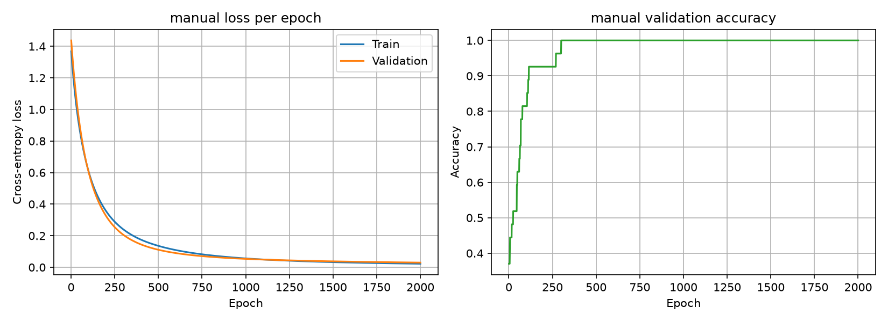
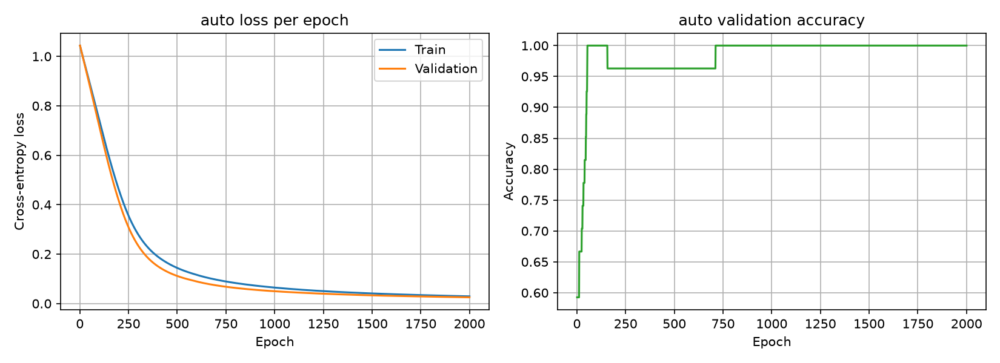

# A neural network from first principles

This project explores how a neural network learns by implementing and training two versions of a classifier on the Wine recognition dataset: a manually implemented model and a PyTorch model built with nn.Module.

The README documents the dataset, the manual gradient calculation, the softmax and cross-entropy derivation, and a comparison of the models' training results. It also includes the steps needed to reproduce the experiments.

The figures below compare the training histories of the two implementations. Each plot shows training loss and validation accuracy over the training epochs, making it easier to compare how the manual and PyTorch models learn.

### Figure 1: Manual Training History


### Figure 2: Auto Training History


## Table of Contents

- [Problem](#problem)
- [Data](#data)
- [Claims](#claims)
  - [The hand-compute gradient agrees with Pytorch Autograd](#the-hand-compute-gradient-agrees-with-pytorch-autograd)
- [Softmax and Cross-Entropy Gradient Derivation](#softmax-and-cross-entropy-gradient-derivation)
- [Data after training Manual and Auto](#data-after-training-the-manual-and-auto)
- [Diagnosis](#diagnosis)
- [Reproducibility](#reproducibility)
  - [Quick Setup](#quick-setup)
  - [Re-running](#re-running)
- [AI Usage](#ai-usage)


## Problem

A colleague has asked for a small classifier on a real table of data, and they
have one concern: they do not trust a result they cannot explain. Frameworks
hide a lot, and "it trains" is not evidence that it is right. So they want to
see the machinery.

You are to build a small neural network classifier in which the gradients are
computed by you, by hand, rather than by the framework. Then you prove those
gradients are correct by checking them against autograd. Then you rebuild the
same classifier the idiomatic way, with `nn.Module` and an optimiser, and show
that the two versions agree with each other. Finally, you package it, test it
and train it on a real dataset, so that someone else can pick it up, run it and
get your numbers.

What matters is that you can say what the abstraction is hiding, and that you
can show it rather than assert it.

## Data

The dataset is the Wine recognition dataset, loaded with
`sklearn.datasets.load_wine` from scikit-learn. It is bundled with the library,
so no download or login is needed. scikit-learn's copy comes from the UCI
Machine Learning Repository
([scikit-learn toy datasets](https://scikit-learn.org/stable/datasets/toy_dataset.html)).

| | |
|---|---|
| Rows | 178 |
| Features | 13, all numeric (chemical measurements such as alcohol, proline, flavanoids) |
| Classes | 3 (`class_0`: 59 rows, `class_1`: 71 rows, `class_2`: 48 rows) |
| Missing values | None |

## Claims

### The hand-compute gradient agrees with Pytorch Autograd

**Claim.** For a double linear layer with softmax and cross-entropy loss, the
manual gradients `dW1`, `dW2`, `db1`, and `db2` match the gradients PyTorch autograd computes
for the same weights and data. Even though the math behind the scene is almost correct, A possible rounding off each
computation drifts the hand-compute and the autograd.
**Tolerance.** I used PyTorch default tolerance `absolute tolerance 1e-5` and `relative tolerance 1.3e-6`

```
pytest -k test_manual_gradient_matches_pytorch_autograd
```

Example Result Weight using PyTorch default Tolerance:

```
Manual
tensor([[ 0.0022,  0.0331, -0.0353],
        [-0.2059,  0.3519, -0.1460],
        [-0.0463, -0.0265,  0.0728],
        [ 0.1888, -0.0548, -0.1340],
        [ 0.0737,  0.0205, -0.0942],
        [ 0.0166,  0.1661, -0.1827],
        [ 0.1844, -0.0798, -0.1046],
        [ 0.0460,  0.1271, -0.1731],
        [-0.1501, -0.0260,  0.1761],
        [-0.0710,  0.1818, -0.1108],
        [-0.0239, -0.1414,  0.1654],
        [ 0.1160, -0.0612, -0.0548],
        [ 0.1366, -0.0656, -0.0710]])
Auto
tensor([[ 0.0022,  0.0331, -0.0353],
        [-0.2059,  0.3519, -0.1460],
        [-0.0463, -0.0265,  0.0728],
        [ 0.1888, -0.0548, -0.1340],
        [ 0.0737,  0.0205, -0.0942],
        [ 0.0166,  0.1661, -0.1827],
        [ 0.1844, -0.0798, -0.1046],
        [ 0.0460,  0.1271, -0.1731],
        [-0.1501, -0.0260,  0.1761],
        [-0.0710,  0.1818, -0.1108],
        [-0.0239, -0.1414,  0.1654],
        [ 0.1160, -0.0612, -0.0548],
        [ 0.1366, -0.0656, -0.0710]])
```

You will see they are bit-to-bit Identical. Now upping the precision up to 10.

```
Manual
tensor([[ 0.0022238293,  0.0330882296, -0.0353120416],
        [-0.2059118748,  0.3518741727, -0.1459622830],
        [-0.0462870710, -0.0264957119,  0.0727827847],
        [ 0.1887748688, -0.0548103005, -0.1339645535],
        [ 0.0736719370,  0.0205490235, -0.0942209512],
        [ 0.0165816788,  0.1660780609, -0.1826597601],
        [ 0.1843553931, -0.0797605142, -0.1045949385],
        [ 0.0459810905,  0.1271382421, -0.1731193364],
        [-0.1500999629, -0.0259582978,  0.1760582477],
        [-0.0709982887,  0.1817865521, -0.1107882559],
        [-0.0239374340, -0.1414229274,  0.1653603464],
        [ 0.1159975901, -0.0612190887, -0.0547785237],
        [ 0.1365945637, -0.0655746907, -0.0710198581]])
Auto
tensor([[ 0.0022238255,  0.0330882147, -0.0353120416],
        [-0.2059118748,  0.3518741727, -0.1459622979],
        [-0.0462870710, -0.0264957026,  0.0727827698],
        [ 0.1887748688, -0.0548102967, -0.1339645535],
        [ 0.0736719370,  0.0205490235, -0.0942209661],
        [ 0.0165816825,  0.1660780609, -0.1826597601],
        [ 0.1843554229, -0.0797605142, -0.1045949385],
        [ 0.0459810905,  0.1271382272, -0.1731193215],
        [-0.1500999629, -0.0259582959,  0.1760582626],
        [-0.0709982887,  0.1817865521, -0.1107882485],
        [-0.0239374284, -0.1414229274,  0.1653603613],
        [ 0.1159975752, -0.0612190887, -0.0547785163],
        [ 0.1365945637, -0.0655746907, -0.0710198656]])
```

They are now not bit-to-bit but still agrees to the PyTorch default tolerance. This goes the same with bias.
Default precision
```
Manual
tensor([ 0.1021, -0.0552, -0.0469])
Auto
tensor([ 0.1021, -0.0552, -0.0469])
```
Upping precision to 10
```
Manual
tensor([ 0.1021387279, -0.0552361421, -0.0469025895])
Auto
tensor([ 0.1021387130, -0.0552361496, -0.0469025783])
```

## Softmax and Cross-Entropy Gradient Derivation

For this derivation, consider one sample with logits for the classes. The Wine
classifier has three classes.

### 1. Softmax

The softmax probability for class $j$ is:
  
$$
P_j = \frac{e^{z_j}}{\displaystyle\sum_{k=1}^{C} e^{z_k}}
$$

Let:

$$
S = \sum_{k=1}^{C} e^{z_k}
$$

Then:


$$
P_i = \frac{e^{z_i}}{S}
$$

### 2. Cross-Entropy

The cross-entropy loss for one sample is:

$$
L = -\sum_{i=1}^{C} y_i \log(P_i)
$$

Differentiate the loss with respect to $P_i$:

$$
\frac{\partial L}{\partial P_i}
= -y_i\frac{\partial}{\partial P_i}\log(P_i)
$$

Since the derivative of $\log(P_i)$ is $1/P_i$:

$$
\boxed{\frac{\partial L}{\partial P_i}=-\frac{y_i}{P_i}}
$$

### 3. Differentiate Softmax with Respect to a Logit

Starting from:

$$
P_i = \frac{e^{z_i}}{S}
$$

Apply the quotient rule with respect to $z_j$:

$$
\frac{\partial P_i}{\partial z_j}
=\frac{
S\frac{\partial e^{z_i}}{\partial z_j}
-e^{z_i}\frac{\partial S}{\partial z_j}
}{S^2}
$$

The two derivatives are:

$$
\frac{\partial e^{z_i}}{\partial z_j}=
\begin{cases}
e^{z_i} & i=j,\\
0 & i\ne j
\end{cases}
$$

and:

$$
\frac{\partial S}{\partial z_j}=e^{z_j}
$$

Now consider the two cases.

**Case A: $i=j$**

$$
\frac{\partial P_i}{\partial z_i}
=\frac{e^{z_i}S-e^{z_i}e^{z_i}}{S^2}
$$

$$
=\frac{e^{z_i}(S-e^{z_i})}{S^2}

$$

$$
=\frac{e^{z_i}}{S}\left(1-\frac{e^{z_i}}{S}\right)
$$

Since $P_i=e^{z_i}/S$:

$$
\boxed{\frac{\partial P_i}{\partial z_i}=P_i(1-P_i)}
$$

**Case B: $i\ne j$**

$$
\frac{\partial P_i}{\partial z_j}
=\frac{-e^{z_i}e^{z_j}}{S^2}
$$

$$
=-\frac{e^{z_i}}{S}\frac{e^{z_j}}{S}
$$

Since $P_i=e^{z_i}/S$ and $P_j=e^{z_j}/S$:

$$
\boxed{\frac{\partial P_i}{\partial z_j}=-P_iP_j}
$$

### 4. Apply the Chain Rule

The loss depends on the logits through the probabilities. Apply the chain
rule:

$$
\frac{\partial L}{\partial z_j}
=\sum_{i=1}^{C}
\frac{\partial L}{\partial P_i}
\frac{\partial P_i}{\partial z_j}
$$

Separate the term where $i=j$ from the terms where $i\ne j$:

$$
\frac{\partial L}{\partial z_j}
= -\frac{y_j}{P_j}P_j(1-P_j)
+\sum_{i\ne j}\left(-\frac{y_i}{P_i}\right)(-P_iP_j)
$$

Cancel the probabilities in each term:

$$
= -y_j(1-P_j)+\sum_{i\ne j}y_iP_j
$$

Expand the first term:  

$$
= -y_j+y_jP_j+\sum_{i\ne j}y_iP_j
$$

Factor out $P_j$ from the last two terms:

$$
= -y_j+P_j\left(y_j+\sum_{i\ne j}y_i\right)
$$

For one-hot encoding, the target values sum to one:

$$
\sum_{i=1}^{C}y_i=1
$$

Therefore:

$$
\frac{\partial L}{\partial z_j}=-y_j+P_j(1)
$$

The final gradient is:

$$
\boxed{\frac{\partial L}{\partial z_j}=P_j-y_j}
$$

## Data After training the Manual and Auto
```
[manual]
loss:     0.5079
accuracy: 85.19%
macro f1: 84.91%
[auto]
loss:     0.3829
accuracy: 92.59%
macro f1: 93.33%
```

## Diagnosis

### 1. Manual model starts with a much higher loss than the auto model

**Observation:** The manual model starts at a loss of about 11. The auto model starts at about 1.2, so the 
manual model started about 10x worse than guessing.

**Reason:** The starting weights are too large. Large weights makes the outputs huge, therefore the model is
confidently sure about a wrong answer, and the loss functions a big loss for that.

**Fix:** I scaled the starting weights the same way `nn.Linear`

**Result:** After the fix, the starting loss is around 1-2 almost the same with the auto model.

### 2. In manual model with 2 layers, the accuracy dropped from 94.44% to 88.89%

**Observation:** After implementing hidden layers, the accuracy dropped from 94.44% to 88.89%

**Reason:** The 1 layer and 2 layer used different data split configuration. The 1 layer, I used 70% train 30% test
but when I implemented the additional layer, I also added the validation split 70% train 15% validation 15% test.
With the first setup, we have 54 test samples, the second setup we have 27 test samples, 94.44% or 54 is 51 correct
predictions, 88.89% of 27 is 24 correct predictions, both misclassified 3 samples.

**Fix** Either re-run the 1 layer using the new data split config, or re-run the two layer usng the previous 
data split config

**Result:** 

### 3. Manual model switch down then up around epochs 250-400

**Observation:** The graph of validation accuracy, around the epoch 250-400, it went down, then up like a switch

**Reason:** This is probably related to the first diagnosis, the starting weight are too large, That's probably a 
cause whythe model is wrongly classifying a class.

**Fix** Scaled the weight the same way with `nn.Linear`

**Result:** After the fix, the switch down dissappeared

****

## Reproducibility

### Quick Setup

Needs Python 3.12. Everything runs on CPU, no GPU needed.

```bash
git clone https://github.com/brown-cookies/qin-pytorch-week-01.git
cd qin-pytorch-week-01
python -m venv .venv
source .venv/bin/activate
python -m pip install -r requirements.txt
python -m pip install --no-deps -e .
python -m pytest
```

### Re-running

**1. Split.** Stratified, `seed = 42` (in `src/config.py`), so two runs give the same indices. The scaler is fitted on the training rows only.

```bash
python -m src.main split --out runs/split.json
```

**2. Smoke training run.** 20 epochs on 32 training rows. It only checks that the training code runs.

```bash
python -m src.main train --smoke --out runs/smoke
```

**3. Full training.** Writes `runs/manual/best_run.pt` (lowest validation loss) and `last_run.pt`.

```bash
python -m src.main train --out runs/manual
```

To train both the manual and the `nn.Module` model and plot their histories, run `python -m src.main run`.

## AI Usage
| File/Function | How it was used |
|---|---|
| `load_data()` | Asked AI for guidance on how to load, process, split training/testing of the wine dataset. Asked the concept for data preparation, StandardScaler |
| `softmax()` and `loss()` | Asked AI to explain the purpose of softmax, cross-entropy, one-hot encoded labels, and the numerical-stability steps used in the implementation. |
| `gradient()` | Used AI explanations to understand the chain rule and how the softmax and cross-entropy derivatives relate to the manual gradient. The handwritten derivation and manual gradient implementation are my own work. |
| `src/plot.py` | Used AI to generate me code for plotting the history of the training model, the training loss, validation accuracy and validation loss. |
| `.github/workflows/ci.yml` | Used AI to draft how to evaluate released checkpoint |